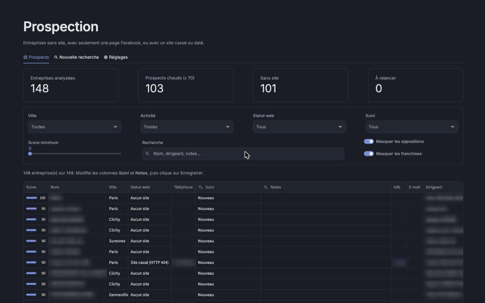

# Outil de prospection : entreprises sans site ou avec un site daté

Trouve les entreprises d'une activité et d'une zone qui n'ont **pas de site**, **seulement une page Facebook / Instagram**, ou un site **cassé, expiré ou daté**, fait vérifier chaque prospect sur le web par un **agent IA** (Claude Sonnet), puis les classe par score dans un fichier Excel.



> **Projet en cours.** Fonctionnel de bout en bout (ligne de commande et interface Streamlit), encore à affiner. L'agent IA qualifie les prospects et propose un angle d'approche ; piste suivante : rédiger le premier message.
>
> Les fichiers de prospects (`data/`), le cache, le suivi et les clés (`.env`) restent en local et ne sont pas versionnés.

## Installation

```bash
cd prospect
python3 -m venv .venv
.venv/bin/pip install -r requirements.txt
cp .env.example .env      # puis remplir les clés voulues (toutes optionnelles)
```

Sans aucune clé, l'outil fonctionne déjà avec les sources gratuites : API de l'État, OpenStreetMap et devinette de domaine. La clé **Anthropic** active l'agent IA (payant à l'usage, plafonné par mois).

## Interface (recommandé)

Double-clique sur **`lancer.command`** dans le Finder, ou tape :

```bash
.venv/bin/streamlit run app.py
```

L'interface s'ouvre sur http://localhost:8501 (accessible uniquement depuis ton ordinateur) avec trois onglets :

- **📋 Prospects** : toutes les entreprises déjà analysées, toutes recherches confondues. Tu peux filtrer par ville, activité, statut web, suivi, score minimum, texte libre, ou n'afficher que les **qualifiés par l'IA**. Le bloc « Qualifier avec l'IA » envoie à l'agent les entreprises de la vue filtrée pas encore vérifiées, avec le coût estimé avant de lancer. Les colonnes **Suivi** (Nouveau, À contacter, Contacté, À relancer, Rendez-vous, Client, Pas intéressé, 🚫 Opposition) et **Notes** se modifient directement dans le tableau, puis bouton « Enregistrer le suivi ». Choisir « 🚫 Opposition » inscrit aussi l'entreprise dans `oppositions.csv`. Le bouton « Exporter la sélection » produit un Excel de la vue filtrée.
- **🔎 Nouvelle recherche** : activité(s) ou code NAF, ville(s) ou département, nombre maximum (jusqu'à 10 000), cases Google Maps et qualification IA. Les résultats s'affichent au fur et à mesure.
- **⚙️ Réglages** : colle ta **clé Anthropic** (testée avant d'être enregistrée ; dépense du mois et coût moyen par entreprise affichés), puis ta **clé SerpAPI**. Elle est testée auprès de SerpAPI (sans consommer de recherche) avant d'être enregistrée dans `.env`, puis le plan et les recherches restantes s'affichent. Les autres clés (PageSpeed, Brave, e-mail de contact) sont dans « Autres clés ».

Le suivi et les notes sont stockés dans `suivi.sqlite`, séparé du cache : ne le supprime pas.

## Exemples en ligne de commande

```bash
# Auto-écoles de deux villes, 200 entreprises maximum
.venv/bin/python prospect.py --activite auto-ecole --ville Clichy --ville Levallois-Perret --limite 200

# Plombiers et chauffagistes de tout le 92
.venv/bin/python prospect.py --activite plombier --activite chauffagiste --departement 92 --limite 300

# Par code NAF et code postal, avec des mots-clés
.venv/bin/python prospect.py --naf 56.10A --cp 75017 --mots-cles pizza

# Sans consommer de crédits payants ou limités
.venv/bin/python prospect.py --activite coiffeur --ville Suresnes --sans-serpapi --sans-brave --sans-pagespeed

# Tous les prospects passent à l'IA, même ceux que les règles jugent peu intéressants
.venv/bin/python prospect.py --activite coiffeur --departement 92 --limite 500 --ia-score-min 0

# Une entreprise demande à ne plus être contactée (RGPD)
.venv/bin/python prospect.py --opposition 123456789 --motif "demande par e-mail le 12/11/2026"
```

Options utiles : `--max-etablissements N` (exclut les réseaux), `--rafraichir` (réanalyse ce qui est déjà en cache), `--sans-ia` (pas de qualification IA), `--ia-score-min N`.
Paris, Lyon et Marseille sont gérées : `--ville Paris` interroge les 20 arrondissements (attention au volume).

Le fichier sort dans `data/prospects_<activite>_<ville>_<date>.xlsx`.

## Fichiers

| Fichier | Rôle |
|---|---|
| `prospect.py` | Ligne de commande |
| `prospection/entreprises.py` | Étape 1 : API Recherche d'entreprises, exclusions |
| `prospection/sites.py` | Étape 2 : recherche du site, validation, statut web |
| `prospection/analyse.py` | Étape 3 : CMS, version, signaux de site daté, RDV, e-mail, PageSpeed |
| `prospection/score.py` | Score sur 100 (règles) |
| `prospection/agent_ia.py` | Étape 5 : agent IA de qualification (Claude Sonnet + recherche web) |
| `prospection/export.py` | Excel (onglets Prospects et Résumé) |
| `prospection/oppositions.py` | Liste d'opposition RGPD |
| `prospection/cache.py`, `reseau.py` | Cache SQLite, pauses entre requêtes, reprises |
| `activites.yaml` | « plombier » → `43.22A`, etc. (à compléter) |
| `empreintes.yaml` | Empreintes des CMS, pages parking, prise de RDV (à compléter) |
| `config.yaml` | Exclusions, débits, plafonds, seuils, pondération du score |
| `oppositions.csv` | Entreprises à ne jamais recontacter (créé au premier usage) |
| `cache.sqlite` | Cache local (supprimable, mais tu perds les quotas du mois et les verdicts de l'IA, qui sont payants) |

## Comment ça marche

**1. Entreprises.** API Recherche d'entreprises, filtrée sur les entreprises actives. On garde l'établissement **actif** situé dans la zone (le siège peut être ailleurs) : c'est son SIRET qui figure dans la colonne « SIRET ». Sont exclues : les entreprises sans établissement actif dans la zone, les entreprises **non diffusibles** (l'entrepreneur s'est opposé auprès de l'INSEE à l'utilisation de ses données par des tiers, l'API masque alors l'adresse par `[NON-DIFFUSIBLE]` : ne pas les prospecter), celles ayant plus de `max_etablissements` établissements ouverts, et celles dont le nom ou l'enseigne contient un mot de la liste `franchises` (en mots entiers : « cer » n'exclut pas « cercle »).

**2. Site**, essayé dans cet ordre (colonne « Source du site ») :
1. **Google Maps via SerpAPI** (si `SERPAPI_KEY`) : site, téléphone, note, nombre d'avis.
2. **OpenStreetMap** (gratuit, ajouté en plus de ta liste) : lieux nommés à moins de 150 m de l'adresse, interrogés par lots de 25 entreprises. Donne parfois le site, la page Facebook ou le téléphone.
3. **Devinette de domaine** : nom et enseigne sans accents ni forme juridique, avec ou sans articles, avec ou sans la ville, en `.fr` et `.com`. DNS d'abord, puis HTTP.
4. **Brave Search** (si `BRAVE_API_KEY`) : `"nom" ville`, en ignorant les annuaires (liste `annuaires` dans `config.yaml`).

**Validation** : un site deviné ou trouvé par moteur n'est retenu que si l'accueil, les mentions légales ou la page contact contiennent :
- le **SIREN/SIRET** → confiance **forte** ;
- le **téléphone** (venant de Google ou d'OSM) → **moyenne** ;
- le **nom + le code postal** (avec au moins un mot distinctif, pas seulement « auto école ») → **faible**.

Exemple réel : `autoecoledelareussite.fr` existe mais appartient à une homonyme de Fosses (95). Le site est rejeté.
Un lien venant d'une fiche Google ou OSM est gardé même sans preuve, avec une confiance faible.

**Statuts** : « Aucun site », « Facebook / Instagram seulement », « Site cassé (HTTP 404 / connexion impossible / page vide ou par défaut) », « Domaine expiré / DNS absent » (y compris les domaines parqués ou à vendre), « Site actif ».

**3. Analyse** (sur la page déjà téléchargée, sans requête de plus) : CMS et gamme (`empreintes.yaml`), version, thème et page builder WordPress, HTTPS, viewport mobile, année du copyright, version de jQuery, Flash, mise en page en tableaux, `<title>`, meta description, temps de réponse, prise de RDV en ligne, formulaire, e-mail visible. PageSpeed mobile en option.
`robots.txt` n'est pas lu : l'outil ne parcourt pas les sites, il fait au plus trois requêtes par site (accueil, mentions légales, contact), comme un visiteur.

**4. Score** sur 100 (pondération dans `config.yaml`) : pas de site, Facebook seul, site cassé ou expiré : 80 à 85. Un site actif part de 25, plus les points de chaque signal de site daté, moins des points pour les constructeurs grand public (Wix, Jimdo…) et les sites modernes (Webflow, Next.js…). Bonus : bonne note Google avec beaucoup d'avis, création récente, pas de prise de RDV en ligne.

**5. Qualification par l'IA** (si `ANTHROPIC_API_KEY`). Les prospects dont le score des règles atteint `ia.score_min` (40 par défaut), hors oppositions et franchises repérées, sont confiés à un agent **Claude Sonnet 5.5** qui utilise la recherche web et la lecture de pages d'Anthropic. Pour chaque entreprise, il cherche la fiche Google, le site, les pages Facebook / Instagram et les annuaires, ouvre le site s'il en trouve un et vérifie qu'il est bien le sien, regarde si l'entreprise est fermée ou appartient à un réseau, puis rend un verdict structuré :
- **présence web réelle** (Aucun site, Facebook / Instagram seulement, Fiche annuaire seulement, Site cassé ou expiré, Site daté, Site correct, Site récent et soigné) et site vérifié ;
- entreprise **active / fermée**, **franchise** ou non, téléphone et e-mail trouvés ;
- **qualifié** ou **écarté**, **score sur 100** (il remplace celui des règles, gardé dans la colonne « Score des règles »), raison, constat sur le site et **angle d'approche** pour un premier message.

L'agent reçoit le pré-diagnostic des règles comme indice : il rattrape surtout les faux « Aucun site » (sites que la devinette n'a pas trouvés) et écarte les entreprises fermées. Il tourne sur 4 entreprises à la fois (`ia.parallele`). Les verdicts sont gardés 180 jours (`ia.validite_jours`) : une entreprise déjà qualifiée ne coûte plus rien.
**Coût** : environ 0,05 à 0,15 $ par entreprise (tokens + 10 $ / 1 000 recherches web) ; la moyenne réelle s'affiche dans les Réglages. La dépense est comptée dans le cache et l'agent s'arrête au plafond `ia.budget_mensuel_usd` (20 $ par mois par défaut). Modèle, effort, nombre de recherches et de pages par entreprise se règlent dans la section `ia` de `config.yaml`.

**Reprise** : tout est en cache dans `cache.sqlite` (entreprise et analyse par SIREN, réponse par URL, appels d'APIs). Si tu interromps le script (Ctrl+C), les résultats déjà obtenus sont exportés. Relance la même commande : les entreprises déjà traitées ne sont pas refaites. Le cache expire après `cache_jours` (30 jours).

## Sources et quotas (vérifiés en octobre 2026)

| Source | Coût | Limites | Réglage |
|---|---|---|---|
| [API Recherche d'entreprises](https://recherche-entreprises.api.gouv.fr/docs/) | Gratuite, sans clé | 7 req/s par IP ; 25 résultats par page ; 10 000 résultats max par recherche | 0,2 s entre requêtes, reprise sur 429 avec `Retry-After` |
| [geo.api.gouv.fr](https://geo.api.gouv.fr) (ville → code commune) | Gratuite, sans clé | — | 0,1 s |
| [OpenStreetMap Overpass](https://wiki.openstreetmap.org/wiki/Overpass_API) | Gratuite, sans clé | Serveur public partagé, souvent lent (≈ 30 s par requête) | 1 requête par lot de 25 entreprises, 5 s de pause |
| [SerpAPI](https://serpapi.com/pricing) Google Maps | Plan gratuit : **250 recherches / mois** (≈ 50 / heure) | 1 recherche par entreprise | Plafond `serpapi.plafond_mensuel: 200`, compté dans le cache, réponses en cache |
| [Brave Search API](https://brave.com/search/api/) | **Plus de plan gratuit illimité** : 5 $ de crédit / mois (≈ 1 000 requêtes), carte bancaire et mention de Brave exigées | 1 req/s | Plafond `brave.plafond_mensuel: 900` |
| [PageSpeed Insights](https://developers.google.com/speed/docs/insights/v5/get-started) | Gratuite avec une clé Google Cloud | 25 000 req / jour | Lent (≈ 15 à 30 s par site) |
| [API Claude](https://platform.claude.com/docs/en/about-claude/pricing) (agent IA) | Payante à l'usage : Sonnet 5.5 à 2 $ / 10 $ par million de tokens, recherche web 10 $ / 1 000 | Limites de débit du compte | Plafond `ia.budget_mensuel_usd: 20`, 5 recherches et 4 pages max par entreprise |
| Pappers | Payante (100 crédits offerts, 1 crédit par fiche) | — | **Non intégrée**, voir plus bas |

Le code NAF utilisé est la nomenclature NAF rév. 2 : l'API renvoie aussi le nouveau code NAF 2025, qui n'est pas encore utilisé pour filtrer.

### Pappers : ce qu'elle apporterait en plus

L'API de l'État fournit déjà : identité, adresse, NAF, dirigeants, tranche d'effectif, nombre d'établissements, et le chiffre d'affaires et le résultat quand les comptes sont publiés.
Pappers ajouterait surtout le **téléphone**, l'**e-mail** et le **site web** déclarés quand elle les a (sur pappers.fr, ces champs ne sont visibles que connecté), plus l'effectif exact et le capital.
Ces champs restent à confirmer par un appel test avec une clé avant l'intégration. Avec 100 crédits, on enrichit 100 fiches au plus.

## RGPD et règles de la prospection B2B

L'outil ne traite que des données d'entreprises issues de sources publiques (registres de l'État, OpenStreetMap, sites des entreprises, fiches Google). Mais les **noms de dirigeants** et les **entreprises individuelles** (dont le nom est celui d'une personne) sont des données personnelles : le RGPD s'applique.

- **Base légale** : intérêt légitime (proposer un service en rapport avec l'activité de l'entreprise).
- **Agent IA** : l'outil envoie à Anthropic le nom, l'enseigne, l'adresse, l'activité et le SIREN de l'entreprise, ainsi que le pré-diagnostic, mais **pas les noms des dirigeants**. Les entreprises en opposition ne sont jamais envoyées. L'agent ne consulte que des pages publiques.
- **Information** : dès le premier contact, dis qui tu es, d'où viennent les coordonnées (« annuaire public des entreprises / votre site ») et comment s'opposer.
- **Opposition** : quand une entreprise refuse, lance aussitôt `--opposition <SIREN>`. Elle reste dans les exports, grisée, avec la mention « OUI — ne pas contacter », et n'est plus analysée. `oppositions.csv` est hors du cache : ne le supprime jamais.
- **E-mail B2B** (art. L34-5 du CPCE, doctrine CNIL) : pas besoin de consentement préalable si le message est **en rapport avec la profession** du destinataire (un site web pour une auto-école, oui). Chaque e-mail doit identifier l'expéditeur et contenir un **lien ou moyen de désinscription** simple et gratuit. Préfère les adresses génériques (`contact@`) aux adresses nominatives.
- **Téléphone** : les appels B2B vers une ligne professionnelle restent possibles sans consentement. Depuis le 11 août 2026, le démarchage téléphonique des **particuliers** exige leur accord préalable (loi du 30 juin 2025 contre les fraudes aux aides publiques). Pour un entrepreneur individuel joint sur un mobile personnel, la frontière est floue : privilégie la ligne de l'entreprise.
- **Durée de conservation** : supprime les prospects qui n'ont pas répondu au bout de **3 ans** après le dernier contact (recommandation CNIL).
- Ne revends ni ne partage ces fichiers.

## Limites connues

- Sans clé SerpAPI ni Brave, la recherche repose sur OSM et la devinette : « Aucun site » est alors plus incertain (confiance faible ou moyenne). Avec SerpAPI, la fiche Google confirme l'absence de site.
- L'analyse ne lit que l'accueil (et les mentions légales ou la page contact pour la validation) : un formulaire placé sur `/contact` peut échapper à la colonne « Formulaire ».
- Une franchise peut passer le filtre si son nom légal ne la trahit pas (ex. une « CER » immatriculée sous un autre nom) : complète la liste `franchises`.
